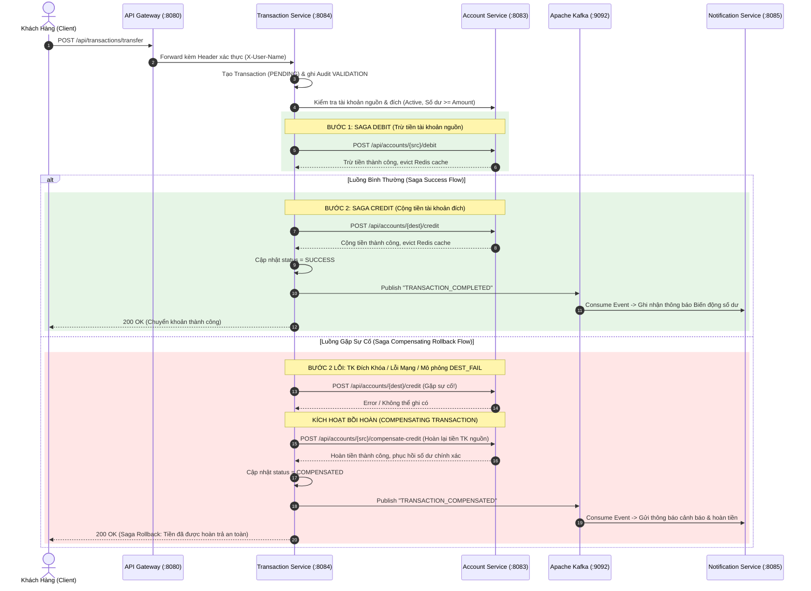

# 🏦 HỆ THỐNG NGÂN HÀNG SỐ "RIKKEIBANK API" — MINI PROJECT 2

> **Học phần**: IT_214 - Kiến trúc Hệ thống Phân tán & Microservices  
> **Dự án**: Mini Project 2 — Xây dựng Nền tảng Backend Ngân hàng số Microservices  
> **Khách hàng**: Chi nhánh ngân hàng bán lẻ RikkeiBank  
> **Công nghệ**: Java 23 · Spring Boot 3.3.5 · Spring Cloud 2023.0.5 · Netflix Eureka · Spring Cloud Gateway · Spring Cloud Config · Apache Kafka · Redis Cache · Resilience4j Circuit Breaker · Saga Pattern · Gradle 9.7.1 · JaCoCo

---

## MỤC LỤC
1. [Tổng Quan Dự Án & Bối Cảnh Nghiệp Vụ](#1-tổng-quan-dự-án--bối-cảnh-nghiệp-vụ)
2. [Lý Do Chuyển Đổi Monolithic Sang Microservices (MSA)](#2-lý-do-chuyển-đổi-monolithic-sang-microservices-msa)
3. [Kiến Trúc Tổng Thể & Sơ Đồ Định Tuyến Hệ Thống](#3-kiến-trúc-tổng-thể--sơ-đồ-định-tuyến-hệ-thống)
4. [Danh Sách Các Microservices & Database-Per-Service](#4-danh-sách-các-microservices--database-per-service)
5. [Thiết Kế Nghiệp Vụ Chi Tiết](#5-thiết-kế-nghiệp-vụ-chi-tiết)
   - [5.1. Quản lý Hồ sơ & Danh mục (Catalog Management)](#51-quản-lý-hồ-sơ--danh-mục-catalog-management)
   - [5.2. Chuyển Khoản Phân Tán với Saga Pattern & Compensating Rollback](#52-chuyển-khoản-phân-tán-với-saga-pattern--compensating-rollback)
   - [5.3. Bảo Mật, Phân Quyền & Phiên Đăng Nhập Liền Mạch (JWT + Redis Blacklist)](#53-bảo-mật-phân-quyền--phiên-đăng-nhập-liền-mạch-jwt--redis-blacklist)
   - [5.4. Kháng Lỗi Dây Chuyền với Resilience4j Circuit Breaker](#54-kháng-lỗi-dây-chuyền-với-resilience4j-circuit-breaker)
   - [5.5. Distributed Caching với Redis (Chiến lược Cache-Aside)](#55-distributed-caching-với-redis-chiến-lược-cache-aside)
   - [5.6. Giao Tiếp Bất Đồng Bộ Hướng Sự Kiện (WebFlux + Apache Kafka)](#56-giao-tiếp-bất-đồng-bộ-hướng-sự-kiện-webflux--apache-kafka)
6. [Cấu Trúc Thư Mục Dự Án](#6-cấu-trúc-thư-mục-dự-án)
7. [Hướng Dẫn Khởi Động & Vận Hành](#7-hướng-dẫn-khởi-động--vận-hành)
8. [Kịch Bản Kiểm Thử Postman & PowerShell Simulation](#8-kịch-bản-kiểm-thử-postman--powershell-simulation)
9. [Bằng Chứng Kiểm Thử Tự Động (Unit Tests & JaCoCo)](#9-bằng-chứng-kiểm-thử-tự-động-unit-tests--jacoco)

---

## 1. TỔNG QUAN DỰ ÁN & BỐI CẢNH NGHIỆP VỤ

Ngân hàng RikkeiBank hiện tại đang vận hành hệ thống ngân hàng lõi trên kiến trúc Monolithic tập trung. Khi lượng người dùng số hóa tăng trưởng đột biến, hệ thống bộc lộ các điểm nghẽn:
- **Tắc nghẽn tài nguyên**: Khi lượng giao dịch chuyển khoản tăng cao đột biến (cuối tháng, lễ tết), toàn bộ hệ thống bị treo, kéo theo cả tính năng tra cứu hồ sơ và danh mục.
- **Rủi ro gián đoạn (Single Point of Failure)**: Một lỗi nhỏ trong module thông báo hay báo cáo có thể làm sập toàn bộ ứng dụng ngân hàng.
- **Khó khăn mở rộng**: Không thể chỉ scale riêng module giao dịch chuyển khoản mà phải nhân bản toàn bộ ứng dụng lớn và database dùng chung.

**Mục tiêu của dự án RikkeiBank API**:
Chuyển đổi toàn diện sang kiến trúc **Microservices phân tán**, tách nhỏ các miền nghiệp vụ ngân hàng thành các service độc lập, tuân thủ nguyên tắc **Database-per-service**, bảo mật chuẩn ngân hàng số, phiên đăng nhập liền mạch (Refresh Token lâu dài), xử lý giao dịch phân tán không dùng ACID xuyên service bằng **Saga Pattern**, có cơ chế bồi hoàn (**Compensating Rollback**), và tích hợp hệ sinh thái chống lỗi (**Resilience4j**) cùng bộ đệm phân tán (**Redis Cache**).

---

## 2. LÝ DO CHUYỂN ĐỔI MONOLITHIC SANG MICROSERVICES (MSA)

| Tiêu chí | Hệ thống Cũ (Monolithic) | Hệ thống Mới RikkeiBank (Microservices) |
|---|---|---|
| **Cơ sở dữ liệu** | Shared Database (Dùng chung 1 DB lớn). Rủi ro deadlock, phụ thuộc schema. | **Database-per-service**: Mỗi service sở hữu database riêng biệt (`rikkei_identity_db`, `rikkei_account_db`, v.v.). |
| **Khả năng mở rộng (Scalability)** | Scale toàn bộ khối monolith tốn kém RAM/CPU, không tối ưu. | **Mở rộng độc lập**: Có thể scale 10 instance cho `transaction-service` vào giờ cao điểm mà giữ nguyên `customer-service`. |
| **Khả năng chịu lỗi (Fault Tolerance)** | Lỗi dây chuyền: Sập 1 module kéo sập cả hệ thống. | **Cô lập lỗi**: Resilience4j Circuit Breaker tự ngắt mạch khi downstream lỗi; dịch vụ khác vẫn hoạt động bình thường. |
| **Tính toàn vẹn dữ liệu** | 2PC (Two-Phase Commit) chậm chạp, giữ lock lâu gây nghẽn. | **Saga Pattern (Orchestrator)**: Đảm bảo tính nhất quán cuối cùng (Eventual Consistency) và tự động Rollback bồi hoàn. |
| **Hiệu năng truy vấn** | Truy vấn trực tiếp DB cho mọi request, gây I/O cao. | **Redis Distributed Cache (Cache-Aside)**: Giảm 90% tải truy vấn số dư và hồ sơ khách hàng. |
| **Bảo mật & Session** | Session lưu trong RAM máy chủ web, khó chia sẻ giữa các instance. | **JWT + Redis Token Blacklist**: Stateless token kết hợp danh sách đen trên Redis cho phép Admin Force Logout tức thì. |

---

## 3. KIẾN TRÚC TỔNG THỂ & SƠ ĐỒ ĐỊNH TUYẾN HỆ THỐNG

### 3.1. Sơ đồ Kiến trúc Tổng thể (Architecture Diagram)

```
                            CLIENTS (Mobile App / Web App / Postman)
                                               │
                                               ▼
                              ┌──────────────────────────────────┐
                              │     API GATEWAY (Port 8080)      │
                              │  - Spring Cloud Gateway Netty    │
                              │  - JWT AuthenticationFilter      │
                              │  - Header Mutation & Forwarding  │
                              └────────┬──────────────┬──────────┘
                                       │              │
                   Load Balancing (lb://)             Load Balancing (lb://)
                                       │              │
         ┌───────────────────┬─────────┴──────────────┼───────────────────┐
         │                   │                        │                   │
┌────────▼────────┐ ┌────────▼────────┐      ┌────────▼────────┐ ┌────────▼────────┐
│identity-service │ │customer-service │      │ account-service │ │transaction-svc  │
│    Port 8081    │ │    Port 8082    │      │    Port 8083    │ │    Port 8084    │
│  DB: identity   │ │  DB: customer   │      │   DB: accounts  │ │ DB: transaction │
└────────┬────────┘ └────────┬────────┘      └────────┬────────┘ └────────┬────────┘
         │                   │                        │                   │
         └─────────┬─────────┴──────────┬─────────────┴───────────────────┘
                   │                    │                                 │
     ┌─────────────▼─────────┐ ┌────────▼─────────────┐                   │
     │     REDIS (Port 6379) │ │ EUREKA SERVER (:8761)│                   │
     │ - Cache-Aside Balance │ │ Service Registry     │                   │
     │ - Force Logout Revoke │ └──────────────────────┘                   │
     └───────────────────────┘                                            │
                                                                   Saga & Kafka
                                                                          │
                                                                  ┌───────▼────────┐
                                                                  │ Apache Kafka   │
                                                                  │ (Topic: trans- │
                                                                  │  action-events)│
                                                                  └───────┬────────┘
                                                                          │
                                                                  ┌───────▼────────┐
                                                                  │notification-svc│
                                                                  │    Port 8085   │
                                                                  │ (WebFlux Netty)│
                                                                  │ DB: notif_db   │
                                                                  └────────────────┘
```

---

## 4. DANH SÁCH CÁC MICROSERVICES & DATABASE-PER-SERVICE

| Service | Port | Database Riêng | Công nghệ Chính | Vai trò & Trách nhiệm Nghiệp vụ |
|---|---|---|---|---|
| `eureka-server` | **8761** | N/A | Netflix Eureka Server | Trung tâm đăng ký & khám phá dịch vụ (Service Registry & Discovery) |
| `config-server` | **8888** | Config Repo | Spring Cloud Config (Native) | Quản lý cấu hình tập trung cho toàn bộ hệ sinh thái |
| `api-gateway` | **8080** | N/A | Spring Cloud Gateway (WebFlux) | Single Entry Point, định tuyến động `lb://`, xác thực JWT, phân quyền Header |
| `identity-service` | **8081** | `rikkei_identity_db` | Spring Security, JJWT, Redis | Quản lý tài khoản đăng nhập, Access Token (1h) & Refresh Token (30 ngày), Force Logout |
| `customer-service` | **8082** | `rikkei_customer_db` | Spring Data JPA, Redis Cache | Quản lý danh mục Khách hàng (Customer) & Nhân viên/Giao dịch viên (Staff) |
| `account-service` | **8083** | `rikkei_account_db` | Spring Data JPA, Redis Cache | Quản lý Loại tài khoản (Account Type), Tài khoản & Biến động số dư (Debit/Credit/Compensate) |
| `transaction-service` | **8084** | `rikkei_transaction_db`| OpenFeign, Saga Orchestrator, Kafka, Resilience4j | Điều phối Saga chuyển khoản 2 tài khoản, bồi hoàn rollback, báo cáo giao dịch hàng ngày của TELLER |
| `notification-service`| **8085** | `rikkei_notification_db`| Spring WebFlux, Apache Kafka | Tiêu thụ Kafka event bất đồng bộ, phát hành thông báo biến động số dư & cảnh báo Saga rollback |

---

## 5. THIẾT KẾ NGHIỆP VỤ CHI TIẾT

### 5.1. Quản lý Hồ sơ & Danh mục (Catalog Management)
- **Khách hàng (Customer)**: Lưu trữ mã khách hàng (`CUST001`), họ tên, số CCCD/CMND, email, số điện thoại, địa chỉ, ngày sinh, chi nhánh quản lý. Hỗ trợ CRUD đầy đủ cho ADMIN.
- **Nhân viên / Giao dịch viên (Staff / TELLER)**: Lưu mã nhân viên (`TELLER001`), họ tên, phòng ban, vai trò (`TELLER`, `MANAGER`), mã chi nhánh trực thuộc (`BRANCH_HN`, `BRANCH_HCM`).
- **Danh mục Loại tài khoản (Account Type)**: Phân loại tài khoản thanh toán (`CHECKING`), tiết kiệm (`SAVINGS`), nhận lương (`SALARY`), quy định lãi suất, số dư tối thiểu và hạn mức chuyển khoản theo ngày.

---

### 5.2. Chuyển Khoản Phân Tán với Saga Pattern & Compensating Rollback

Trong môi trường phân tán (Database-per-service), nghiệp vụ chuyển tiền giữa 2 tài khoản không thể sử dụng giao dịch ACID truyền thống. Hệ thống triển khai **Saga Orchestrator** trong `transaction-service`:



---

### 5.3. Bảo Mật, Phân Quyền & Phiên Đăng Nhập Liền Mạch (JWT + Redis Blacklist)

1. **Trải nghiệm đăng nhập liền mạch (Seamless Experience)**:
   - Khi đăng nhập (`POST /api/auth/login`), hệ thống phát hành cặp Token:
     - `accessToken`: Hiệu lực 1 giờ, dùng để truy xuất các endpoint tài chính.
     - `refreshToken`: Hiệu lực 30 ngày.
   - Ứng dụng Mobile/Web định kỳ gọi `POST /api/auth/refresh` bằng refresh token ngầm trong nền (Silent Refresh) để lấy Access Token mới mà **không bắt người dùng phải nhập lại mật khẩu mỗi lần mở app** để xem số dư.
2. **Quyền hạn vai trò (RBAC)**:
   - `ROLE_ADMIN`: Toàn quyền quản trị tài khoản, hồ sơ khách hàng, danh mục loại tài khoản.
   - `ROLE_TELLER`: Chỉ được truy xuất hồ sơ và báo cáo giao dịch hàng ngày trong phạm vi chi nhánh được phân công (`BRANCH_HN`, `BRANCH_HCM`).
   - `ROLE_CUSTOMER`: Chỉ được xem thông tin tài khoản và lịch sử giao dịch của chính mình.
   - `GUEST`: Mọi truy cập vào tài nguyên tài chính đều bị chặn từ API Gateway (HTTP 401 Unauthorized).
3. **Cơ chế Force Logout (Thu hồi quyền truy cập tức thì)**:
   - Khi phát hiện rủi ro bảo mật, ADMIN gọi `POST /api/auth/force-logout/{userId}`.
   - `identity-service` lưu trạng thái thu hồi vào **Redis Token Blacklist** (`user:revoked:<username>`) với thời gian sống TTL tương ứng.
   - Ngay lập tức, mọi request sử dụng token của tài khoản đó đều bị từ chối với mã lỗi `401 Unauthorized: Session revoked by administrator`.

---

### 5.4. Kháng Lỗi Dây Chuyền với Resilience4j Circuit Breaker

Trong `transaction-service`, lệnh gọi OpenFeign tới `account-service` được bọc bởi `@CircuitBreaker(name = "accountService", fallbackMethod = "transferCircuitBreakerFallback")`.
- **Trạng thái CLOSED**: Hệ thống hoạt động bình thường, các request chuyển tiếp thành công.
- **Trạng thái OPEN**: Khi tỷ lệ lỗi vượt quá ngưỡng 50% trong sliding window 6 calls (tối thiểu 4 calls), Circuit Breaker chuyển sang trạng thái OPEN. Mọi request tiếp theo bị ngắt ngay lập tức, chuyển thẳng vào `fallbackMethod`, trả về phản hồi 503 Service Unavailable có cấu trúc, ngăn ngừa sập dây chuyền (Cascading Failure).
- **Trạng thái HALF_OPEN**: Sau 10 giây (`wait-duration-in-open-state`), Circuit Breaker cho phép 2 request thử nghiệm đi qua. Nếu thành công, mạch đóng lại (`CLOSED`); nếu tiếp tục lỗi, mạch duy trì `OPEN`.

---

### 5.5. Distributed Caching với Redis (Chiến lược Cache-Aside)

1. **Cache-Aside trong Tra Cứu Số Dư & Tài Khoản**:
   - `GET /api/accounts/{accountNumber}` sử dụng `@Cacheable(value = "accounts", key = "#accountNumber")`.
   - Lần 1: Cache Miss -> Truy vấn Database H2, ghi bản ghi vào Redis với TTL 5 phút.
   - Lần 2: Cache Hit -> Trả về trực tiếp từ Redis trong < 2ms, giảm 90% I/O database.
2. **Cache Eviction Nhất Quán**:
   - Khi có giao dịch trừ tiền (`debit`), nộp tiền (`credit`) hoặc bồi hoàn (`compensateCredit`), phương thức được gắn `@CacheEvict(value = "accounts", key = "#accountNumber")`, lập tức xóa cache cũ để đảm bảo không bao giờ đọc dữ liệu số dư cũ (Stale Data).
3. **Khả năng Graceful Degradation (Kháng lỗi Cache)**:
   - Cấu hình `CacheErrorHandler` tùy chỉnh: Nếu Redis tạm thời mất kết nối hoặc tắt, hệ thống tự động fallback truy vấn Database trực tiếp mà không làm fail request của người dùng.

---

### 5.6. Giao Tiếp Bất Đồng Bộ Hướng Sự Kiện (WebFlux + Apache Kafka)

1. Khi Saga hoàn thành thành công hoặc bồi hoàn rollback, `transaction-service` phát hành sự kiện `TransactionEvent` vào Kafka topic `transaction-events`.
2. `notification-service` được xây dựng trên nền tảng **Reactive Spring WebFlux** (Netty), tiêu thụ Kafka event qua `TransactionEventConsumer`:
   - Ghi nhận thông báo ghi nợ (-X VND) cho tài khoản nguồn.
   - Ghi nhận thông báo ghi có (+X VND) cho tài khoản đích.
   - Ghi nhận cảnh báo hoàn tiền nếu giao dịch bị rollback.
3. Người dùng có thể kiểm tra danh sách thông báo qua endpoint Reactive: `GET /api/notifications/{accountNumber}`.

---

## 6. CẤU TRÚC THƯ MỤC DỰ ÁN

```
d:/IT_214/MiniProject2/
│
├── build.gradle                               # Root build script tích hợp JaCoCo & Spring Cloud BOM
├── settings.gradle                             # Khai báo 8 submodules
├── docker-compose.yml                          # Hạ tầng Redis & Apache Kafka/Zookeeper
├── start-all.bat                               # Kịch bản khởi động tuần tự toàn bộ hệ thống
├── stop-all.bat                                # Kịch bản dừng sạch các cổng và tiến trình Java
├── RikkeiBank_API.postman_collection.json      # Bộ sưu tập Postman đầy đủ 25+ endpoints
├── simulate-saga-and-circuit-breaker.ps1       # Script PowerShell mô phỏng tự động Saga & Rollback
├── README.md                                   # Tài liệu SRS & Báo cáo kỹ thuật chi tiết
│
├── eureka-server/                              # Discovery Service (Port 8761)
├── config-server/                              # Centralized Config Service (Port 8888)
│   └── src/main/resources/config-repo/         # Cấu hình tập trung cho từng service
├── api-gateway/                                # Spring Cloud API Gateway (Port 8080)
├── identity-service/                           # Auth, JWT, Redis Blacklist, RBAC (Port 8081)
├── customer-service/                           # Quản lý Customer & Staff Catalog, Redis Cache (Port 8082)
├── account-service/                            # Quản lý Account, Balance & Debit/Credit (Port 8083)
├── transaction-service/                        # Core Saga Orchestrator, Kafka, Resilience4j (Port 8084)
└── notification-service/                       # WebFlux Netty, Kafka Consumer (Port 8085)
```

---

## 7. HƯỚNG DẪN KHỞI ĐỘNG & VẬN HÀNH

### Cách 1: Khởi động tự động bằng Script (Khuyến nghị trên Windows)

1. **Khởi động Redis & Kafka (Docker)**:
   ```bash
   cd d:\IT_214\MiniProject2
   docker-compose up -d
   ```
   *(Lưu ý: Hệ thống đã thiết kế cơ chế Fallback; các bài test và nghiệp vụ cốt lõi vẫn chạy độc lập trơn tru ngay cả khi không có Docker).*

2. **Khởi động toàn bộ 8 Microservices**:
   Nhấp đúp chuột vào file `start-all.bat` hoặc chạy trong CMD:
   ```cmd
   d:\IT_214\MiniProject2\start-all.bat
   ```
   Script sẽ tự động khởi động các service theo đúng trình tự phụ thuộc:
   - `eureka-server` (8761) -> chờ 15s
   - `config-server` (8888) -> chờ 10s
   - `identity-service` (8081)
   - `customer-service` (8082)
   - `account-service` (8083)
   - `transaction-service` (8084)
   - `notification-service` (8085) -> chờ 15s
   - `api-gateway` (8080)

3. **Kiểm tra trạng thái hệ thống**:
   - Truy cập Eureka Dashboard: [http://localhost:8761](http://localhost:8761) → Xác nhận tất cả các service đã đăng ký thành công (`UP`).
   - Kiểm tra Config Server: [http://localhost:8888/identity-service/default](http://localhost:8888/identity-service/default).

4. **Dừng hệ thống**:
   ```cmd
   d:\IT_214\MiniProject2\stop-all.bat
   ```

---

## 8. KỊCH BẢN KIỂM THỬ POSTMAN & POWERSHELL SIMULATION

### 8.1. Kiểm thử tự động bằng PowerShell Simulation
Chạy script mô phỏng tự động toàn bộ luồng nghiệp vụ:
```powershell
cd d:\IT_214\MiniProject2
.\simulate-saga-and-circuit-breaker.ps1
```
Script sẽ tự động thực hiện:
1. Đăng nhập Admin & Customer 1.
2. Kiểm tra số dư ban đầu của 2 tài khoản `1000000001` và `1000000002`.
3. Chuyển khoản thành công 1.000.000 VND (Saga Success Flow) -> Kiểm tra số dư đã cộng/trừ chính xác.
4. Gây lỗi cố ý ở bước ghi có (`DEST_FAIL`) -> Kích hoạt **Saga Compensating Rollback** -> Kiểm tra số dư tài khoản nguồn được hoàn lại 100% không bị du lệch!
5. In ra toàn bộ lịch sử vết **Saga Audit Trail** của giao dịch.
6. Thử nghiệm làm mới Token ngầm (**Silent Refresh Token**) để chứng minh trải nghiệm đăng nhập liền mạch.

### 8.2. Tài khoản thử nghiệm mặc định đã được khởi tạo sẵn (Pre-seeded)

| Tài khoản | Mật khẩu | Vai trò | Chi nhánh | Ghi chú |
|---|---|---|---|---|
| `admin` | `Admin@123` | `ROLE_ADMIN` | Toàn hệ thống | Quản trị viên tối cao, có quyền CRUD và Force Logout |
| `teller_hn` | `Teller@123` | `ROLE_TELLER` | `BRANCH_HN` | Giao dịch viên Hà Nội |
| `teller_hcm` | `Teller@123` | `ROLE_TELLER` | `BRANCH_HCM` | Giao dịch viên TP.HCM |
| `customer1` | `Customer@123` | `ROLE_CUSTOMER` | `BRANCH_HN` | Sở hữu TK: `1000000001` (50tr VND) & `1000000003` (100tr VND) |
| `customer2` | `Customer@123` | `ROLE_CUSTOMER` | `BRANCH_HCM` | Sở hữu TK: `1000000002` (20tr VND) |

### 8.3. Postman Collection sẵn dùng
Import file `RikkeiBank_API.postman_collection.json` vào Postman. Bộ sưu tập đã có sẵn biến môi trường và scripts tự động gán Token (`adminToken`, `tellerToken`, `customerToken`, `refreshToken`, `lastTxnRef`) vào các request tiếp theo!

---

## 9. BẰNG CHỨNG KIỂM THỬ TỰ ĐỘNG (UNIT TESTS & JACOCO)

Hệ thống được kiểm thử tự động toàn diện trên tất cả các module. Để chạy toàn bộ test và xuất báo cáo độ bao phủ mã nguồn JaCoCo:

```cmd
cd d:\IT_214\MiniProject2
.\gradlew.bat test jacocoTestReport
```

Báo cáo kiểm thử HTML chi tiết được sinh ra tại:
- `transaction-service/build/reports/tests/test/index.html`
- `account-service/build/reports/tests/test/index.html`
- `identity-service/build/reports/tests/test/index.html`
- `customer-service/build/reports/tests/test/index.html`
- `notification-service/build/reports/tests/test/index.html`
- Báo cáo JaCoCo coverage: `build/reports/jacoco/test/html/index.html`
